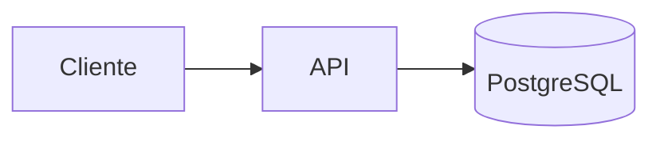

# Manual de uso: MkDocs y Sphinx

> **Categoría:** Documentación · **Utilidad:** Generan la documentación del proyecto
> **Tipo:** Paquetes externos (requieren instalación) · MkDocs: Markdown · Sphinx: reStructuredText y Markdown (MyST)

---

## Índice

1. [Descripción](#1-descripción)
2. [Estado del ecosistema (noviembre de 2026)](#2-estado-del-ecosistema-noviembre-de-2026)
3. [Instalación](#3-instalación)
4. [Conceptos clave](#4-conceptos-clave)
5. [Docstrings: la base de la documentación de la API](#5-docstrings-la-base-de-la-documentación-de-la-api)
6. [MkDocs: primeros pasos](#6-mkdocs-primeros-pasos)
7. [MkDocs: `mkdocs.yml`, navegación y tema Material](#7-mkdocs-mkdocsyml-navegación-y-tema-material)
8. [MkDocs: extensiones de Markdown](#8-mkdocs-extensiones-de-markdown)
9. [MkDocs: documentación de la API con mkdocstrings](#9-mkdocs-documentación-de-la-api-con-mkdocstrings)
10. [Sphinx: primeros pasos](#10-sphinx-primeros-pasos)
11. [Sphinx: `conf.py` y extensiones](#11-sphinx-confpy-y-extensiones)
12. [Sphinx: reStructuredText y MyST](#12-sphinx-restructuredtext-y-myst)
13. [Sphinx: documentación de la API con autodoc](#13-sphinx-documentación-de-la-api-con-autodoc)
14. [Verificación: enlaces, ejemplos y avisos](#14-verificación-enlaces-ejemplos-y-avisos)
15. [Publicación: GitHub Pages, GitLab Pages y Read the Docs](#15-publicación-github-pages-gitlab-pages-y-read-the-docs)
16. [Versionado e internacionalización](#16-versionado-e-internacionalización)
17. [Ejemplo práctico completo](#17-ejemplo-práctico-completo)
18. [Errores frecuentes](#18-errores-frecuentes)
19. [Buenas prácticas](#19-buenas-prácticas)
20. [Referencia rápida](#20-referencia-rápida)
21. [Ejercicios propuestos](#21-ejercicios-propuestos)
22. [Referencias](#22-referencias)

---

## 1. Descripción

**MkDocs** y **Sphinx** son generadores de sitios estáticos especializados en documentación técnica. A partir de archivos de texto (y de los *docstrings* del código) generan un sitio web navegable, con búsqueda, índice y referencia de la API.

| | **MkDocs** | **Sphinx** |
|---|---|---|
| Formato de origen | Markdown | reStructuredText (`.rst`) o Markdown con **MyST** |
| Configuración | `mkdocs.yml` (YAML) | `conf.py` (Python) |
| Referencia de la API | *Plugin* **mkdocstrings** | Extensiones **autodoc**, **autosummary**, **napoleon** |
| Salidas | HTML | HTML, PDF (LaTeX), ePub, *man pages*, texto |
| Referencias cruzadas | Enlaces Markdown y *autorefs* | Muy potentes (`:func:`, `:class:`, **intersphinx** entre proyectos) |
| Curva de aprendizaje | Baja | Media |
| Uso típico | Documentación de aplicaciones, APIs y librerías modernas (FastAPI, Pydantic) | Librerías y proyectos grandes (CPython, NumPy, Django), documentación impresa |

**Ventajas comunes:**
- La documentación vive junto al código, en el mismo repositorio y con las mismas revisiones.
- Referencia de la API generada desde los *docstrings*: siempre sincronizada.
- Búsqueda integrada, temas profesionales y publicación gratuita (GitHub/GitLab Pages, Read the Docs).

**Limitaciones:**
- La documentación narrativa (guías, tutoriales) hay que escribirla y mantenerla.
- Ecosistemas de *plugins* con distinto grado de mantenimiento (véase la sección 2).

---

## 2. Estado del ecosistema (noviembre de 2026)

Antes de elegir, tenga en cuenta la situación actual:

- **MkDocs 1.6** (última versión publicada: 1.6.1, agosto de 2024) sigue funcionando, pero su desarrollo está prácticamente detenido. El autor original anunció en enero de 2026 una versión **2.0 incompatible con los *plugins*** actuales; el ecosistema la ha recibido con reservas.
- **Material for MkDocs**, el tema más usado, entró en **modo mantenimiento** en noviembre de 2025 y su periodo de correcciones críticas terminó el **5 de noviembre de 2026**. Sus autores se han centrado en **Zensical**, un nuevo generador que lee los archivos `mkdocs.yml` existentes.
- Han surgido continuaciones comunitarias (por ejemplo, **ProperDocs**, que se presenta como sustituto directo de MkDocs 1.x, y bifurcaciones de Material).
- **Sphinx** mantiene un desarrollo activo (versión 9.x en 2026, requiere Python ≥ 3.12).

Recomendaciones prácticas:

| Situación | Recomendación |
|---|---|
| Proyecto existente con MkDocs + Material | Siga funcionando, **fije versiones** (`mkdocs>=1.6,<2`, `mkdocs-material>=9.7,<10`) y planifique la evaluación de Zensical u otra alternativa. |
| Proyecto nuevo con preferencia por Markdown | Evalúe **Zensical** (configuración compatible) o Sphinx + MyST; si usa MkDocs 1.6, hágalo con versiones fijadas. |
| Librería con mucha API, referencias cruzadas o PDF | **Sphinx**. |

> Lo que se explica de MkDocs en este manual (estructura, `mkdocs.yml`, Markdown, mkdocstrings) se aplica en gran medida a las alternativas compatibles.

---

## 3. Instalación

Como grupo de dependencias de documentación:

```bash
# MkDocs
uv add --group docs "mkdocs>=1.6,<2" "mkdocs-material>=9.7,<10" "mkdocstrings[python]>=0.27"

# Sphinx
uv add --group docs "sphinx>=9" "myst-parser>=4" furo sphinx-autobuild
```

Comprobar:

```bash
uv run mkdocs --version
uv run sphinx-build --version
```

---

## 4. Conceptos clave

| Concepto | Descripción |
|---|---|
| Generador estático | Convierte archivos de texto en HTML que se sirve sin servidor de aplicaciones. |
| Tema | Aspecto visual y componentes (navegación, búsqueda, modo oscuro). |
| Navegación | Estructura de páginas del sitio. |
| *Docstring* | Cadena de documentación de módulos, clases y funciones. |
| Referencia de la API | Páginas generadas automáticamente a partir del código y sus *docstrings*. |
| Referencia cruzada | Enlace a otra sección, función o clase (incluso de otro proyecto). |
| Admonición | Bloque destacado: nota, aviso, peligro, consejo. |
| Directiva / rol (Sphinx) | Bloques (`.. note::`) y elementos en línea (`:func:`) de reStructuredText. |
| Modo estricto | Convertir los avisos en errores para no publicar documentación rota. |

Marco recomendado para organizar el contenido (**Diátaxis**):

| Tipo | Propósito | Ejemplo |
|---|---|---|
| Tutoriales | Aprender haciendo | «Tu primer pedido en 10 minutos» |
| Guías prácticas | Resolver una tarea concreta | «Cómo exportar pedidos a CSV» |
| Referencia | Descripción técnica exacta | API generada, opciones de configuración |
| Explicación | Entender el porqué | «Arquitectura y decisiones de diseño» |

---

## 5. Docstrings: la base de la documentación de la API

Elija un estilo y úselo en todo el proyecto. El más legible es el **estilo Google**:

```python
def convertir(importe: Decimal, origen: str, destino: str, tipos: dict[str, Decimal]) -> Decimal:
    """Convierte un importe entre dos divisas.

    El importe se convierte primero a euros y después a la divisa de destino,
    redondeando al céntimo con redondeo bancario.

    Args:
        importe: Cantidad a convertir.
        origen: Código ISO 4217 de la divisa de origen (p. ej. ``"USD"``).
        destino: Código ISO 4217 de la divisa de destino.
        tipos: Tipos de cambio respecto al euro, por código de divisa.

    Returns:
        El importe convertido, con dos decimales.

    Raises:
        DivisaDesconocida: Si alguna de las divisas no está en ``tipos``.

    Examples:
        >>> tipos = {"EUR": Decimal("1"), "USD": Decimal("1.05")}
        >>> convertir(Decimal("100"), "EUR", "USD", tipos)
        Decimal('105.00')
    """
```

| Estilo | Ejemplo de sección | Soporte |
|---|---|---|
| Google | `Args:`, `Returns:`, `Raises:` | mkdocstrings, Sphinx (napoleon) |
| NumPy | `Parameters\n----------` | mkdocstrings, Sphinx (napoleon) |
| reStructuredText (Sphinx) | `:param importe:` | Sphinx nativo, mkdocstrings |

> Con anotaciones de tipo en la firma, no repita los tipos en el *docstring*: ambas herramientas los toman de la firma.

Compruebe el estilo con Ruff (reglas `D`, con `convention = "google"`).

---

## 6. MkDocs: primeros pasos

```bash
uv run mkdocs new .                   # Crea mkdocs.yml y docs/index.md
uv run mkdocs serve                   # Servidor local con recarga: http://127.0.0.1:8000
uv run mkdocs serve -a 0.0.0.0:8001
uv run mkdocs build                   # Genera el sitio en site/
uv run mkdocs build --strict          # Falla ante avisos (enlaces rotos, páginas fuera de nav…)
uv run mkdocs gh-deploy               # Publica en la rama gh-pages
```

Estructura:

```
proyecto/
├── mkdocs.yml
└── docs/
    ├── index.md
    ├── guias/
    │   ├── instalacion.md
    │   └── exportar.md
    ├── referencia/
    │   └── api.md
    └── imagenes/
        └── arquitectura.png
```

Añada `site/` a `.gitignore`.

---

## 7. MkDocs: `mkdocs.yml`, navegación y tema Material

```yaml
site_name: Tienda
site_description: Documentación del servicio de pedidos
site_url: https://empresa.github.io/tienda/
repo_url: https://github.com/empresa/tienda
repo_name: empresa/tienda
edit_uri: edit/main/docs/
copyright: © 2026 Empresa S.A.

nav:
  - Inicio: index.md
  - Guías:
      - Instalación: guias/instalacion.md
      - Exportar pedidos: guias/exportar.md
  - Referencia:
      - API: referencia/api.md
      - Configuración: referencia/configuracion.md
  - Historial de cambios: changelog.md

theme:
  name: material
  language: es
  palette:
    - media: "(prefers-color-scheme: light)"
      scheme: default
      primary: indigo
      toggle: { icon: material/weather-night, name: Modo oscuro }
    - media: "(prefers-color-scheme: dark)"
      scheme: slate
      primary: indigo
      toggle: { icon: material/weather-sunny, name: Modo claro }
  features:
    - navigation.tabs
    - navigation.sections
    - navigation.top
    - navigation.footer
    - search.suggest
    - search.highlight
    - content.code.copy
    - content.code.annotate
    - content.action.edit

plugins:
  - search:
      lang: es

extra_css: [estilos/extra.css]
validation:
  omitted_files: warn
  absolute_links: warn
  unrecognized_links: warn
```

| Clave | Uso |
|---|---|
| `site_name`, `site_url` | Nombre y URL pública (necesaria para enlaces canónicos y el mapa del sitio). |
| `nav` | Navegación explícita (si se omite, se genera por orden alfabético). |
| `theme` | Tema y sus opciones. |
| `plugins` | *Plugins* activos (al declararlos, hay que incluir `search` explícitamente). |
| `markdown_extensions` | Extensiones de Markdown (sección 8). |
| `extra_css` / `extra_javascript` | Recursos propios. |
| `validation` | Qué se considera aviso (y error con `--strict`). |
| `watch` | Carpetas adicionales que recargan `mkdocs serve` (p. ej. `src/`). |

---

## 8. MkDocs: extensiones de Markdown

```yaml
markdown_extensions:
  - admonition
  - attr_list
  - def_list
  - footnotes
  - md_in_html
  - tables
  - toc:
      permalink: true
  - pymdownx.details
  - pymdownx.superfences:
      custom_fences:
        - name: mermaid
          class: mermaid
          format: !!python/name:pymdownx.superfences.fence_code_format
  - pymdownx.highlight:
      anchor_linenums: true
  - pymdownx.inlinehilite
  - pymdownx.snippets:
      base_path: [.]
      check_paths: true
  - pymdownx.tabbed:
      alternate_style: true
  - pymdownx.tasklist:
      custom_checkbox: true
```

Uso en las páginas:

````markdown
!!! warning "Importante"
    El contrareembolso no admite pedidos de más de 500 €.

??? info "Detalles (desplegable)"
    Contenido oculto por defecto.

=== "uv"

    ```bash
    uv add tienda
    ```

=== "pip"

    ```bash
    pip install tienda
    ```

```python title="ejemplo.py" linenums="1" hl_lines="3"
from tienda import convertir

total = convertir(Decimal("100"), "EUR", "USD", tipos)
```



--8<-- "CHANGELOG.md"
````

> `pymdownx.snippets` permite incluir archivos (como el `CHANGELOG.md` de la raíz) sin duplicarlos.

---

## 9. MkDocs: documentación de la API con mkdocstrings

```yaml
plugins:
  - search
  - autorefs
  - mkdocstrings:
      handlers:
        python:
          paths: [src]
          inventories:
            - https://docs.python.org/3/objects.inv
            - https://docs.pydantic.dev/latest/objects.inv
          options:
            docstring_style: google
            show_source: false
            show_root_heading: true
            show_signature_annotations: true
            separate_signature: true
            members_order: source
            merge_init_into_class: true
            filters: ["!^_"]
            show_if_no_docstring: false
```

En una página Markdown, el identificador `:::` inserta la documentación de un objeto:

```markdown
# Referencia de la API

::: tienda.divisas
    options:
      members: [convertir, obtener_tipos]

::: tienda.modelos.Pedido
```

Referencias cruzadas automáticas (*autorefs*) en cualquier página:

```markdown
Use [`convertir`][tienda.divisas.convertir] para cambiar de divisa.
Devuelve un [`Decimal`][decimal.Decimal].
```

Generar páginas para todos los módulos automáticamente (*plugins* `gen-files` y `literate-nav`):

```python
# docs/gen_ref_pages.py
from pathlib import Path

import mkdocs_gen_files

nav = mkdocs_gen_files.Nav()
for ruta in sorted(Path("src").rglob("*.py")):
    modulo = ruta.relative_to("src").with_suffix("")
    partes = tuple(modulo.parts)
    if partes[-1] == "__init__":
        partes = partes[:-1]
    elif partes[-1].startswith("_"):
        continue
    destino = Path("referencia", *partes).with_suffix(".md")
    nav[partes] = destino.relative_to("referencia").as_posix()
    with mkdocs_gen_files.open(destino, "w") as f:
        f.write(f"::: {'.'.join(partes)}\n")

with mkdocs_gen_files.open("referencia/SUMMARY.md", "w") as f:
    f.writelines(nav.build_literate_nav())
```

---

## 10. Sphinx: primeros pasos

```bash
uv run sphinx-quickstart docs --sep -p Tienda -a "Equipo Tienda" -l es --ext-autodoc --ext-viewcode --no-batchfile
uv run sphinx-build -M html docs/source docs/build            # Construir HTML
uv run sphinx-build -M html docs/source docs/build -W --keep-going   # Avisos = errores
uv run sphinx-autobuild docs/source docs/build/html           # Servidor con recarga
uv run sphinx-build -M latexpdf docs/source docs/build        # PDF (requiere LaTeX)
uv run sphinx-build -M linkcheck docs/source docs/build       # Comprobar enlaces
```

Estructura (con `--sep`):

```
docs/
├── Makefile
├── source/
│   ├── conf.py
│   ├── index.rst          # o index.md con MyST
│   ├── _static/
│   └── _templates/
└── build/                 # Generado (no versionar)
```

---

## 11. Sphinx: `conf.py` y extensiones

```python
# docs/source/conf.py
from importlib.metadata import version as version_paquete

project = "Tienda"
author = "Equipo Tienda"
copyright = "2026, Empresa S.A."
release = version_paquete("tienda")
version = ".".join(release.split(".")[:2])
language = "es"

extensions = [
    "sphinx.ext.autodoc",          # Documentación desde los docstrings
    "sphinx.ext.autosummary",      # Tablas resumen y páginas por objeto
    "sphinx.ext.napoleon",         # Docstrings estilo Google/NumPy
    "sphinx.ext.intersphinx",      # Enlaces a la documentación de otros proyectos
    "sphinx.ext.viewcode",         # Enlace al código fuente
    "sphinx.ext.doctest",          # Ejecutar los ejemplos
    "myst_parser",                 # Markdown (MyST)
    "sphinx_copybutton",           # Botón de copiar en los bloques de código
]

source_suffix = {".rst": "restructuredtext", ".md": "markdown"}
exclude_patterns = ["_build"]

# autodoc
autodoc_typehints = "description"            # Tipos en la descripción de parámetros
autodoc_member_order = "bysource"
autodoc_default_options = {"members": True, "show-inheritance": True, "undoc-members": False}
autosummary_generate = True
napoleon_google_docstring = True
napoleon_numpy_docstring = False

# intersphinx
intersphinx_mapping = {
    "python": ("https://docs.python.org/3", None),
    "pydantic": ("https://docs.pydantic.dev/latest", None),
}

# MyST
myst_enable_extensions = ["colon_fence", "deflist", "fieldlist", "tasklist", "attrs_inline"]
myst_heading_anchors = 3

# Rigor
nitpicky = True                              # Avisa de referencias que no se resuelven
nitpick_ignore = [("py:class", "decimal.Decimal")]

# HTML
html_theme = "furo"
html_title = f"Tienda {release}"
html_static_path = ["_static"]
html_theme_options = {
    "source_repository": "https://github.com/empresa/tienda/",
    "source_branch": "main",
    "source_directory": "docs/source/",
}
```

Temas recomendados:

| Tema | Paquete | Estilo |
|---|---|---|
| Furo | `furo` | Limpio, modo oscuro, muy legible. |
| PyData | `pydata-sphinx-theme` | Proyectos científicos (NumPy, pandas). |
| Book | `sphinx-book-theme` | Libros y cursos. |
| Read the Docs | `sphinx-rtd-theme` | Clásico. |
| Immaterial | `sphinx-immaterial` | Aspecto similar a Material for MkDocs. |

---

## 12. Sphinx: reStructuredText y MyST

### 12.1 reStructuredText

```rst
Exportar pedidos
================

Subsección
----------

Texto con *cursiva*, **negrita** y ``código``. Enlace a :func:`tienda.divisas.convertir`
y a :class:`decimal.Decimal` (vía intersphinx). Referencia a otra sección: :ref:`instalacion`.

.. note::

   Las exportaciones se generan en UTF-8 con separador ``;``.

.. code-block:: python
   :caption: ejemplo.py
   :emphasize-lines: 2

   from tienda import exportar_csv
   exportar_csv("pedidos.csv")

.. toctree::
   :maxdepth: 2
   :caption: Guías

   guias/instalacion
   guias/exportar
```

### 12.2 MyST (Markdown para Sphinx)

````markdown
# Exportar pedidos

Texto con *cursiva*, **negrita** y `código`. Enlace a {func}`tienda.divisas.convertir`
y a {class}`decimal.Decimal`. Referencia a otra sección: {ref}`instalacion`.

:::{note}
Las exportaciones se generan en UTF-8 con separador `;`.
:::

```{code-block} python
:caption: ejemplo.py
:emphasize-lines: 2

from tienda import exportar_csv
exportar_csv("pedidos.csv")
```

```{toctree}
:maxdepth: 2
:caption: Guías

guias/instalacion
guias/exportar
```
````

| Elemento | reStructuredText | MyST |
|---|---|---|
| Rol | `` :func:`x` `` | `` {func}`x` `` |
| Directiva | `.. note::` | ` ```{note} ` o `:::{note}` |
| Etiqueta | `.. _instalacion:` | `(instalacion)=` |

---

## 13. Sphinx: documentación de la API con autodoc

```rst
Referencia de la API
====================

.. automodule:: tienda.divisas
   :members:

.. autoclass:: tienda.modelos.Pedido
   :members:
   :exclude-members: model_config

.. autofunction:: tienda.divisas.convertir

.. autosummary::
   :toctree: generado
   :recursive:

   tienda
```

En MyST:

````markdown
```{eval-rst}
.. automodule:: tienda.divisas
   :members:
```
````

> autodoc **importa** los módulos para leer sus *docstrings*: el paquete debe estar instalado (o en `sys.path`) y su importación no debe tener efectos secundarios (conexiones, lectura de configuración obligatoria). Use `autodoc_mock_imports = ["libreria_pesada"]` para dependencias no disponibles en la construcción.

Alternativa sin importar el código: **sphinx-autoapi** (análisis estático).

---

## 14. Verificación: enlaces, ejemplos y avisos

| Comprobación | MkDocs | Sphinx |
|---|---|---|
| Avisos como errores | `mkdocs build --strict` | `sphinx-build -W --keep-going` |
| Enlaces internos rotos | `--strict` + `validation` | `nitpicky = True` |
| Enlaces externos | *Plugin* `htmlproofer` o `lychee` en CI | `sphinx-build -M linkcheck` |
| Ejemplos del código | `pytest --doctest-modules` | `sphinx-build -M doctest` / `pytest --doctest-modules` |
| Ortografía | `codespell`, Vale | `sphinxcontrib-spelling`, Vale |
| Estilo de *docstrings* | Ruff `D` | Ruff `D` |
| Cobertura de documentación | `interrogate` | `sphinx.ext.coverage`, `interrogate` |

```bash
uv run pytest --doctest-modules src/                # Los ejemplos >>> de los docstrings deben funcionar
uvx interrogate -v --fail-under 90 src/             # Porcentaje de objetos con docstring
```

---

## 15. Publicación: GitHub Pages, GitLab Pages y Read the Docs

### 15.1 GitHub Pages con GitHub Actions

```yaml
name: Documentación
on:
  push:
    branches: [main]
permissions:
  contents: read
  pages: write
  id-token: write
concurrency:
  group: pages
  cancel-in-progress: false

jobs:
  construir:
    runs-on: ubuntu-latest
    steps:
      - uses: actions/checkout@v4
      - uses: astral-sh/setup-uv@v6
      - run: uv sync --locked --group docs
      - run: uv run mkdocs build --strict           # o: uv run sphinx-build -W -b html docs/source site
      - uses: actions/upload-pages-artifact@v3
        with:
          path: site
  publicar:
    needs: construir
    runs-on: ubuntu-latest
    environment:
      name: github-pages
      url: ${{ steps.despliegue.outputs.page_url }}
    steps:
      - id: despliegue
        uses: actions/deploy-pages@v4
```

Active en **Settings → Pages → Source: GitHub Actions**.

### 15.2 GitLab Pages

```yaml
pages:
  image: ghcr.io/astral-sh/uv:python3.13-bookworm-slim
  script:
    - uv sync --locked --group docs
    - uv run mkdocs build --strict --site-dir public
  artifacts:
    paths: [public]
  rules:
    - if: $CI_COMMIT_BRANCH == $CI_DEFAULT_BRANCH
```

### 15.3 Read the Docs

```yaml
# .readthedocs.yaml
version: 2
build:
  os: ubuntu-24.04
  tools:
    python: "3.13"
  jobs:
    create_environment:
      - asdf plugin add uv
      - asdf install uv latest
      - asdf global uv latest
    install:
      - UV_PROJECT_ENVIRONMENT=$READTHEDOCS_VIRTUALENV_PATH uv sync --locked --group docs
sphinx:
  configuration: docs/source/conf.py
  fail_on_warning: true
# Para MkDocs:
# mkdocs:
#   configuration: mkdocs.yml
#   fail_on_warning: true
```

Read the Docs construye cada versión y rama, ofrece búsqueda en el servidor y vistas previas de las *pull requests*.

---

## 16. Versionado e internacionalización

### 16.1 Varias versiones de la documentación

- **MkDocs**: *plugin* `mike` (publica cada versión en una carpeta de `gh-pages` con selector):

  ```bash
  uv run mike deploy --push --update-aliases 1.4 latest
  uv run mike set-default --push latest
  ```

- **Sphinx**: Read the Docs (versiones automáticas por etiqueta) o `sphinx-multiversion`.

### 16.2 Traducciones

- **Sphinx**: `gettext` integrado (`sphinx-build -b gettext`, `sphinx-intl`).
- **MkDocs**: *plugins* `mkdocs-static-i18n`.

---

## 17. Ejemplo práctico completo

**Documentación del paquete `tienda` con las dos herramientas**: el mismo módulo documentado con *docstrings* de estilo Google, un sitio MkDocs + Material + mkdocstrings y un sitio Sphinx + MyST + Furo, ambos construidos en modo estricto, más un script que verifica los ejemplos de los *docstrings*.

### 17.1 Código documentado (`src/tienda/divisas.py`)

```python
"""Conversión de importes entre divisas.

Los tipos de cambio se expresan siempre respecto al euro (EUR = 1).

Examples:
    >>> from decimal import Decimal
    >>> tipos = {"EUR": Decimal("1"), "USD": Decimal("1.05")}
    >>> convertir(Decimal("100"), "EUR", "USD", tipos)
    Decimal('105.00')
"""
from __future__ import annotations

from decimal import ROUND_HALF_EVEN, Decimal

__all__ = ["DivisaDesconocida", "convertir"]


class DivisaDesconocida(ValueError):
    """La divisa indicada no figura en la tabla de tipos de cambio.

    Attributes:
        codigo: Código ISO 4217 que no se ha encontrado.
    """

    def __init__(self, codigo: str) -> None:
        super().__init__(f"Divisa desconocida: {codigo}")
        self.codigo = codigo


def convertir(importe: Decimal, origen: str, destino: str, tipos: dict[str, Decimal]) -> Decimal:
    """Convierte un importe entre dos divisas.

    El importe se convierte primero a euros y después a la divisa de destino,
    redondeando al céntimo con redondeo bancario.

    Args:
        importe: Cantidad a convertir.
        origen: Código ISO 4217 de la divisa de origen (p. ej. ``"USD"``).
        destino: Código ISO 4217 de la divisa de destino.
        tipos: Tipos de cambio respecto al euro, por código de divisa.

    Returns:
        El importe convertido, con dos decimales.

    Raises:
        DivisaDesconocida: Si alguna de las divisas no está en ``tipos``.

    Examples:
        >>> tipos = {"EUR": Decimal("1"), "USD": Decimal("1.05"), "GBP": Decimal("0.84")}
        >>> convertir(Decimal("105"), "USD", "GBP", tipos)
        Decimal('84.00')
    """
    origen, destino = origen.upper(), destino.upper()
    for codigo in (origen, destino):
        if codigo not in tipos:
            raise DivisaDesconocida(codigo)
    resultado = importe / tipos[origen] * tipos[destino]
    return resultado.quantize(Decimal("0.01"), rounding=ROUND_HALF_EVEN)
```

### 17.2 Sitio MkDocs

`mkdocs.yml`:

```yaml
site_name: Tienda
site_url: https://empresa.github.io/tienda/
repo_url: https://github.com/empresa/tienda

nav:
  - Inicio: index.md
  - Guía rápida: guia.md
  - Referencia: referencia.md

theme:
  name: material
  language: es
  features: [navigation.sections, content.code.copy, search.suggest]

plugins:
  - search:
      lang: es
  - autorefs
  - mkdocstrings:
      handlers:
        python:
          paths: [src]
          inventories: [https://docs.python.org/3/objects.inv]
          options:
            docstring_style: google
            show_root_heading: true
            show_source: false
            separate_signature: true
            show_signature_annotations: true

markdown_extensions:
  - admonition
  - pymdownx.superfences
  - pymdownx.highlight
  - toc:
      permalink: true

validation:
  omitted_files: warn
  unrecognized_links: warn
```

`docs/index.md`:

```markdown
# Tienda

Librería para gestionar pedidos y convertir importes entre divisas.

!!! tip "Empiece aquí"
    Consulte la [guía rápida](guia.md) y, para el detalle de cada función, la [referencia](referencia.md).
```

`docs/guia.md`:

````markdown
# Guía rápida

Para convertir 100 € a dólares use [`convertir`][tienda.divisas.convertir]:

```python
from decimal import Decimal
from tienda.divisas import convertir

tipos = {"EUR": Decimal("1"), "USD": Decimal("1.05")}
convertir(Decimal("100"), "EUR", "USD", tipos)   # Decimal('105.00')
```

!!! warning
    Si la divisa no existe se lanza [`DivisaDesconocida`][tienda.divisas.DivisaDesconocida].
````

`docs/referencia.md`:

```markdown
# Referencia de la API

::: tienda.divisas
```

```bash
uv run mkdocs build --strict
```

### 17.3 Sitio Sphinx

Para poder comparar ambas herramientas en el mismo repositorio, el sitio Sphinx se coloca en `docs_sphinx/` (MkDocs usa `docs/`). En un proyecto real, elija una sola.

`docs_sphinx/conf.py`:

```python
project = "Tienda"
author = "Equipo Tienda"
language = "es"
extensions = [
    "sphinx.ext.autodoc",
    "sphinx.ext.napoleon",
    "sphinx.ext.intersphinx",
    "sphinx.ext.viewcode",
    "myst_parser",
]
source_suffix = {".rst": "restructuredtext", ".md": "markdown"}
autodoc_typehints = "description"
autodoc_member_order = "bysource"
napoleon_google_docstring = True
intersphinx_mapping = {"python": ("https://docs.python.org/3", None)}
myst_enable_extensions = ["colon_fence"]
nitpicky = True
html_theme = "furo"
html_title = "Tienda"
```

`docs_sphinx/index.md`:

````markdown
# Tienda

Librería para gestionar pedidos y convertir importes entre divisas.

:::{tip}
Consulte la {doc}`guia` y la {doc}`referencia`.
:::

```{toctree}
:hidden:

guia
referencia
```
````

`docs_sphinx/guia.md`:

````markdown
# Guía rápida

Para convertir 100 € a dólares use {func}`tienda.divisas.convertir`:

```python
from decimal import Decimal
from tienda.divisas import convertir

tipos = {"EUR": Decimal("1"), "USD": Decimal("1.05")}
convertir(Decimal("100"), "EUR", "USD", tipos)   # Decimal('105.00')
```

:::{warning}
Si la divisa no existe se lanza {class}`~tienda.divisas.DivisaDesconocida`.
:::
````

`docs_sphinx/referencia.md`:

````markdown
# Referencia de la API

```{eval-rst}
.. automodule:: tienda.divisas
   :members:
```
````

```bash
uv run sphinx-build -W --keep-going -b html docs_sphinx docs_sphinx/_build/html
```

### 17.4 Verificar los ejemplos y la cobertura de *docstrings*

```bash
uv run pytest --doctest-modules src/tienda -q
uvx interrogate -v src/tienda
```

```text
$ uv run pytest --doctest-modules src/tienda -q
..                                                                       [100%]
2 passed in 0.05s
```

---

## 18. Errores frecuentes

| Error | Causa | Solución |
|---|---|---|
| `mkdocstrings: Could not collect 'tienda.x'` | El paquete no se encuentra. | `paths: [src]` en el *handler* o instale el proyecto. |
| `Doc file 'x.md' contains a link 'y.md', but the target is not found` | Enlace roto. | Corrija la ruta (relativa a la página). |
| `The following pages exist in the docs directory, but are not included in the "nav"` | Página fuera de la navegación. | Añádala a `nav` o elimínela. |
| Aviso de Material sobre MkDocs 2.0 | El tema advierte de la incompatibilidad con MkDocs 2. | Fije `mkdocs<2`. |
| `WARNING: autodoc: failed to import module` (Sphinx) | El módulo no se puede importar (no instalado, dependencias, efectos al importar). | Instale el proyecto, `autodoc_mock_imports` o evite efectos al importar. |
| `py:class reference target not found` | `nitpicky` y una referencia sin destino. | Añada intersphinx del proyecto correspondiente o `nitpick_ignore`. |
| `toctree contains reference to nonexisting document` | Ruta errónea en el `toctree`. | Rutas relativas sin extensión. |
| `document isn't included in any toctree` | Página huérfana. | Inclúyala en un `toctree` o marque `:orphan:`. |
| Los tipos aparecen dos veces | Tipos en firma y en el *docstring*. | Quite los tipos del *docstring*; `autodoc_typehints = "description"`. |
| El sitio funciona en local pero no en GitHub Pages (rutas) | `site_url`/base incorrecta. | Configure `site_url` con la ruta del repositorio. |

---

## 19. Buenas prácticas

- Documente **todas las APIs públicas** con *docstrings* de un único estilo (Google recomendado) y verifique con Ruff `D` e `interrogate`.
- Incluya **ejemplos ejecutables** (`>>>`) y pruébelos con `pytest --doctest-modules`.
- Organice el contenido según **Diátaxis**: tutoriales, guías, referencia y explicación.
- Genere la referencia de la API desde el código; escriba a mano solo la parte narrativa.
- Construya en **modo estricto** en CI (`--strict`, `-W`) y compruebe los enlaces.
- Publique automáticamente desde la rama principal y ofrezca vistas previas en las PR.
- Fije las versiones de las herramientas de documentación en un grupo `docs` del bloqueo.
- Dada la situación de MkDocs (sección 2), fije `mkdocs<2` y planifique la evolución (Zensical, alternativas compatibles o Sphinx).
- Mantenga un `CHANGELOG.md` e inclúyalo en el sitio.

---

## 20. Referencia rápida

```bash
# MkDocs
mkdocs new . · mkdocs serve · mkdocs build [--strict] · mkdocs gh-deploy · mike deploy 1.4 latest

# Sphinx
sphinx-quickstart docs --sep
sphinx-build -M html docs/source docs/build [-W --keep-going]
sphinx-build -M linkcheck|doctest|latexpdf docs/source docs/build
sphinx-autobuild docs/source docs/build/html
```

```yaml
# mkdocs.yml
site_name · site_url · nav · theme: { name: material } · plugins: [search, mkdocstrings] · markdown_extensions
```

```markdown
::: paquete.modulo                      (mkdocstrings)
!!! note "Título"                       (admonición MkDocs)
{func}`paquete.funcion`  ·  :::{note}   (MyST / Sphinx)
```

```python
# conf.py
extensions = ["sphinx.ext.autodoc", "sphinx.ext.napoleon", "sphinx.ext.intersphinx", "myst_parser"]
html_theme = "furo" · intersphinx_mapping = {...} · nitpicky = True
```

---

## 21. Ejercicios propuestos

1. Añada *docstrings* de estilo Google a un módulo propio, active Ruff `D` y alcance un 90 % en `interrogate`.
2. Cree un sitio MkDocs con Material, una guía y la referencia de la API con mkdocstrings; constrúyalo con `--strict`.
3. Construya la misma documentación con Sphinx + MyST + Furo y compare la experiencia y el resultado.
4. Configure la publicación automática en GitHub Pages o GitLab Pages desde la rama principal.
5. Evalúe la migración del sitio MkDocs a Zensical (u otra alternativa compatible) y documente qué *plugins* funcionan y cuáles no.

---

## 22. Referencias

- MkDocs: https://www.mkdocs.org/
- Material for MkDocs: https://squidfunk.github.io/mkdocs-material/
- Zensical: https://zensical.org/
- mkdocstrings: https://mkdocstrings.github.io/
- Sphinx: https://www.sphinx-doc.org/es/master/
- MyST Parser: https://myst-parser.readthedocs.io/
- Furo: https://pradyunsg.me/furo/
- Read the Docs: https://docs.readthedocs.com/
- Diátaxis: https://diataxis.fr/
- Guía de estilo de docstrings de Google: https://google.github.io/styleguide/pyguide.html#38-comments-and-docstrings
